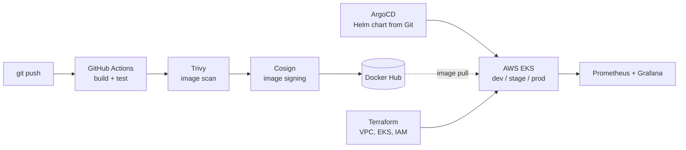

<picture>
  <source media="(prefers-color-scheme: dark)" srcset="banner-dark.svg">
  
</picture>

  
  
  

  <b>I build the path from <code>git push</code> to production – and the monitoring that proves it works.</b>

---

### About me

- **~4 years** in cloud and DevOps engineering: 3+ years at **Cognizant** on the RELX (LexisNexis) account, and before that **Cloud Support Engineer** at Debots, Hyderabad
- I design reusable CI/CD pipelines, run Kubernetes on **AKS** and **EKS**, manage infrastructure with **Terraform** and **Ansible**, and release through **GitOps**
- **MSc Computing Science**, Griffith College Dublin (2026) · **BTech Computer Science** (2021)
- **Now building:** SRE portfolio projects – SLOs, alerting and runbooks
- **Looking for:** DevOps, Platform or SRE roles in Ireland and the EU

### Experience

| Role | Company | Period |
|---|---|---|
| **DevOps Engineer** | Cognizant · client RELX (LexisNexis) | Sep 2021 – Jan 2025 |
| **Cloud Support Engineer** | Debots, Hyderabad | Jan 2021 – Sep 2021 |

<b>What I delivered</b> (click to expand)

 

- **CI/CD at scale** – reusable pipeline templates in Jenkins, GitHub Actions and Azure DevOps adopted by other teams; caching and parallel jobs to speed up builds; per-branch preview environments
- **Kubernetes platforms** – AKS and EKS clusters provisioned with Terraform; workloads shipped with Helm and ArgoCD, including blue/green releases
- **Security in the pipeline** – policy-as-code checks, secrets management and container image scanning built into delivery
- **Operations** – Prometheus, Grafana, ELK and Loki; log-based alerting; on-call rotation, runbooks and automated ITIL change requests
- **People** – mentored junior engineers; tracked DORA metrics to find delivery bottlenecks
- **Cloud foundations (Debots)** – AWS deployments with reusable Terraform modules for EC2, S3, VPC and IAM; Jenkins pipelines integrated with GitLab; CloudWatch monitoring

---

### Featured project · OmniShop Enterprise Platform

A microservices e-commerce platform that takes code from commit to a **scanned, signed and monitored** deployment on Kubernetes.

| | |
|---|---|
| **Infrastructure** | Terraform for VPC, EKS and IAM · remote state in S3 with DynamoDB locking |
| **Keyless CI** | GitHub Actions authenticates to AWS with OIDC – no long-lived keys |
| **Supply chain** | Every image scanned with Trivy and signed with Cosign |
| **GitOps** | ArgoCD syncs one Helm chart across dev, stage and prod |
| **Observability** | Prometheus and Grafana, fed by a synthetic load generator |
| **Cost control** | Python (boto3) teardown script removes every resource after testing |
| **Try it** | `docker compose up --build` runs the full stack locally in ~2 minutes |

---

### Tech stack

  

  
  
  
  
  
  
  
  
  
  

---

### How I work

- **Everything in Git** – infrastructure, pipelines and config are reviewed and versioned like application code
- **Security early** – scanning, signing and policy checks run in the pipeline, not after release
- **Done means observable** – a service isn't finished until it has dashboards, alerts and a runbook
- **Templates over tickets** – reusable pipelines let teams ship without waiting on DevOps

---

### Certifications

Verify: [Microsoft Learn profile](https://learn.microsoft.com/en-us/users/kiransubrahamanyasaibandarucogniza-1028/)

---

  Open to DevOps, Platform and SRE roles in Ireland and the EU · <a href="https://www.linkedin.com/in/kiransai006">Let's talk on LinkedIn</a>

