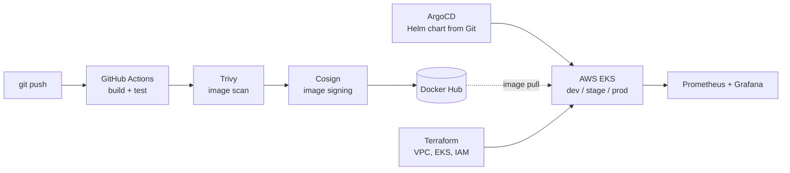

<h1 align="center">Kiran Subrahamanya Sai Bandaru</h1>

  <b>DevOps Engineer</b> · Kubernetes · Terraform · CI/CD · GitOps · AWS &amp; Azure
   
  Dublin, Ireland · Open to DevOps, Platform and SRE roles across Ireland and the EU

  
  
  

---

## About

- DevOps engineer with about 4 years in cloud and platform roles: 3+ years at **Cognizant** on the RELX (LexisNexis) account, and before that Cloud Support Engineer at **Debots**, Hyderabad
- I own the delivery path end to end: reusable CI/CD pipelines, infrastructure as code, Kubernetes platforms on AKS and EKS, GitOps releases and the monitoring that tells us when something breaks
- MSc in Computing Science, Griffith College Dublin (2026) · BTech in Computer Science (2021)
- Current focus: platform engineering, software supply-chain security and SRE practice (SLOs, on-call, DORA metrics)

## What I've delivered at work

- **CI/CD at scale** – built reusable pipeline templates in Jenkins, GitHub Actions and Azure DevOps that other teams adopted; added caching and parallel jobs to speed up builds; set up per-branch preview environments
- **Kubernetes platforms** – provisioned and ran AKS and EKS clusters with Terraform; shipped workloads with Helm and ArgoCD, including blue/green releases
- **Security in the pipeline** – policy-as-code checks, secrets management and container image scanning built into delivery, not bolted on after
- **Operations** – Prometheus, Grafana, ELK and Loki for observability; moved alerting to log-based signals; on-call rotation, runbooks and automated ITIL change requests
- **People** – mentored junior engineers and tracked DORA metrics to show where delivery was slowing down
- **Cloud foundations (Debots)** – AWS deployments with reusable Terraform modules for EC2, S3, VPC and IAM; Jenkins pipelines integrated with GitLab; CloudWatch monitoring; Git branching and code review

## Featured project · OmniShop Enterprise Platform

A microservices e-commerce platform I built to show the full path from `git push` to a signed, scanned, monitored deployment on Kubernetes.
**Repo:** [OmniShop-Enterprise-Platform](https://github.com/Kiransai006/OmniShop-Enterprise-Platform-main)

- **Infrastructure as code** – Terraform for VPC, EKS and IAM, with remote state in S3 and DynamoDB state locking
- **Keyless CI** – GitHub Actions authenticates to AWS through OIDC, so no long-lived access keys sit in the repo
- **Supply-chain security** – every image is scanned with Trivy and signed with Cosign before it reaches the registry
- **GitOps** – ArgoCD syncs one Helm chart across dev, stage and prod
- **Observability** – Prometheus and Grafana dashboards, with a load generator feeding live traffic
- **Cost control** – a Python (boto3) teardown script removes every resource after a test run
- **Runs locally** – `docker compose up --build` brings up the full stack in about two minutes, no AWS account needed

`React` `Flask` `Docker` `Kubernetes` `Helm` `Terraform` `ArgoCD` `GitHub Actions` `Trivy` `Cosign` `Prometheus` `Grafana` `AWS EKS`

## Tech stack

| Area | Tools |
|---|---|
| **Cloud** |    |
| **Containers** |     |
| **IaC &amp; config** |    |
| **CI/CD** |     |
| **Observability** |     |
| **Security** |    |
| **Languages** |     |
| **Data &amp; messaging** |      |
| **Platform** |   |

## Certifications

- Microsoft Certified: Azure Fundamentals
- Microsoft Certified: Azure Data Fundamentals
- AWS Certified Cloud Practitioner

Verified credentials: [Microsoft Learn profile](https://learn.microsoft.com/en-us/users/kiransubrahamanyasaibandarucogniza-1028/)

---

  Open to DevOps, Platform and SRE roles in Ireland and the EU. 
  Happy to talk CI/CD design, Kubernetes platforms and GitOps – <a href="https://www.linkedin.com/in/kiransai006">connect on LinkedIn</a>.

